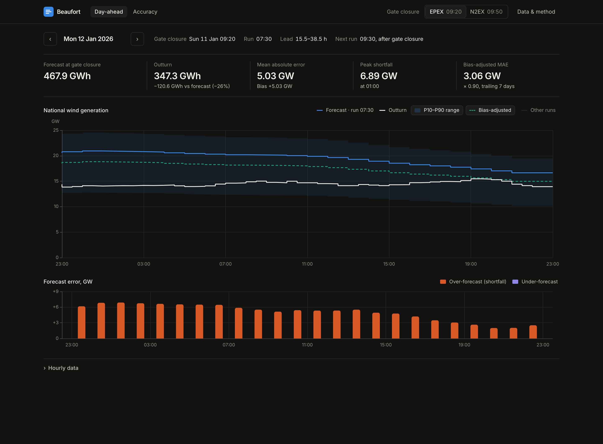
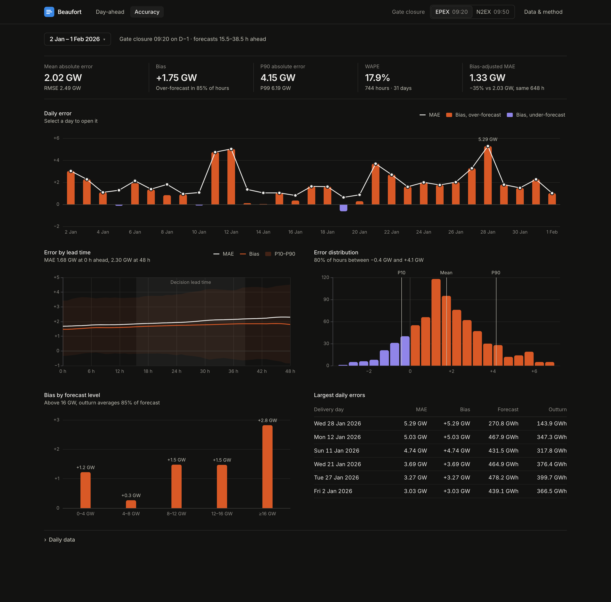

# Beaufort

Day-ahead wind forecast monitoring for GB. For each delivery day it shows the latest national wind forecast that was available at day-ahead gate closure, and measures how accurate those forecasts turned out to be. The data comes from Elexon BMRS: WINDFOR forecasts and FUELHH `WIND` outturn, covering purchase decisions made in January 2026.

**Live app:** <https://nqv7kx.vercel.app>





**What the January data shows** (09:20 gate closure, 744 delivery hours):
- **Bias dominates.** The forecast available at gate closure overstates delivered wind by **+1.75 GW** on average (MAE 2.02 GW). It is too high in **85%** of hours, and worse at high wind: above 16 GW, outturn averages 85% of forecast.
- **Waiting barely helps.** The 09:30 run (bidding on N2EX instead of EPEX) improves MAE by only about 1%.
- **A simple correction helps a lot.** A trailing 7-day correction, using only data known at gate closure, cuts MAE by **35%** (2.03 → 1.33 GW).
- **Tail risk.** P90 absolute error is 4.15 GW, which is the number to size a wind-shortfall hedge against.

Details: [docs/methodology.md](docs/methodology.md) · Design: [docs/architecture.md](docs/architecture.md) · Decisions: [docs/decisions.md](docs/decisions.md)

## Run it

### Docker (recommended)

```bash
docker compose up --build
```

Then open <http://localhost:8080>. The `web` container (nginx) serves the built frontend and proxies `/api` to the `api` container (FastAPI/uvicorn).

### Local development

Requires Python 3.12 with [uv](https://docs.astral.sh/uv/), and Node 22.

```bash
make install
make dev        # API on :8000, web on :5173 (Vite proxies /api to the API)
make test       # pytest + vitest
make lint
make types      # regenerate frontend API types from the FastAPI schema
```

API docs: `/api/docs` (Swagger UI), `/api/openapi.json`.

## Web app

**Day-ahead** (`/day-ahead/:date`) answers "what will I plan against, and how did it turn out?" for one delivery day:
- **Header line:** the gate closure, the forecast run used, its lead time, and the next run (which arrives too late for the decision).
- **Summary figures:** forecast vs outturn energy, MAE and bias, peak shortfall, and the bias-adjusted MAE.
- **Main chart:** hourly forecast against half-hourly outturn. Toggles add the P10–P90 range, the bias-adjusted line, and the other runs (solid if published before gate closure, dashed if after).
- **Error strip:** forecast error per hour, with a crosshair linked to the main chart.
- **Hourly data table.**

**Accuracy** (`/accuracy`) answers "how far can I trust it?" over a period (the full window or any week):
- **Headline figures:** MAE, bias with the share of over-forecast hours, P90/P99 absolute error, WAPE, and the bias-adjusted MAE on the same hours.
- **Daily error:** bias bars plus an MAE line; click a day to open it in Day-ahead.
- **Error by lead time:** error for forecasts published 0–48 h ahead, with the decision lead time shaded.
- **Error distribution:** signed error histogram with P10, mean and P90 marked.
- **Bias by forecast level.**
- **Largest daily errors:** the worst days, each linked to its Day-ahead view.
- **Daily data table.**

All state is in the URL (`?gc=09:50&adj=1&runs=1&band=0`), so every view can be shared as a link. The ← and → keys step through days, and the neighbouring days are prefetched. The page follows the system light/dark setting.

Stack: React 19, TypeScript, Vite, React Router, TanStack Query, Tailwind v4, Radix Popover, ECharts.
- **Colours:** defined once as CSS tokens and read by the ECharts theme. The series palette was checked for colour-blind separation and contrast in both themes.
- **API types:** generated from the backend OpenAPI schema (`make types`).

## Data

The app reads a committed snapshot, `data/beaufort.sqlite`, so it never calls Elexon at request time. Rebuild it with:

```bash
make ingest                         # or: docker compose run --rm ingest
```

The ingest:
1. Pulls WINDFOR forecasts (runs published 29 Dec 2025 → 2 Feb 2026) and FUELHH `WIND` actuals (settlement days 31 Dec 2025 → 2 Feb 2026) from `data.elexon.co.uk/bmrs/api/v1` in 7-day chunks, retrying with backoff.
2. Validates every row; invalid rows are counted and skipped.
3. Dedupes and upserts the rows into SQLite.
4. Writes `data/manifest.json`, which records the source parameters, row counts, a content hash (`data_sha256`, the same on every rebuild) and a data-quality report: missing settlement periods, runs per day, off-schedule runs.

Current snapshot:
- 20,440 forecast points (280 runs × 73 hourly points) and 1,632 half-hourly actuals.
- No gaps.
- One late run (15 Jan 12:25 instead of 11:30).

## Method

| Concept | Definition |
|---|---|
| Delivery day D | 23:00 D-1 → 23:00 D, UK local (GB day-ahead auction / EFA day) |
| Gate closure | 09:20 UK on D-1 (EPEX GB 60-min, default) or 09:50 (N2EX) |
| Forecast used for hour T | Latest WINDFOR run with `publishTime ≤ gate closure` and `publishTime < T` |
| Actual for hour T | FUELHH `WIND` half-hour starting at T |
| Error | forecast − actual (positive = over-forecast = wind shortfall vs plan) |
| Metrics | MAE, RMSE, bias, WAPE, P50/P90/P99 abs error, share of over-forecast hours. No MAPE: it explodes at low wind |
| Lead-time curve | Same rule with cutoff T − H for H = 0…48 h |
| Bias-adjusted forecast | Forecast × Σactual/Σforecast over the previous 7 days of decision-time pairs. Uses only actuals published before gate closure, needs ≥ 72 h of history |
| Uncertainty band | Forecast × P10/P90 of hourly actual/forecast ratios in the same trailing window |

The January figures above are pinned as regression tests in `backend/tests/services/test_golden.py`. The full definitions, data quirks, results table and assumptions are in [docs/methodology.md](docs/methodology.md).

## API

All endpoints are `GET` and return JSON with MW integers and UTC timestamps. Bad input returns 422 with an `application/problem+json` body. Responses carry an `ETag` and are cached by the CDN.

| Endpoint | Params |
|---|---|
| `/api/v1/meta` | Coverage, gate-closure presets, run schedule, snapshot manifest |
| `/api/v1/day-ahead` | `delivery_date`, `gate_closure` (HH:MM, default 09:20) |
| `/api/v1/day-ahead/runs` | `delivery_date`, `gate_closure`. Every run for the day, flagged available or not at gate closure |
| `/api/v1/accuracy` | `from`, `to`, `gate_closure`. Summary, adjusted vs raw, daily, by hour, by forecast level, histogram |
| `/api/v1/accuracy/lead-time` | `from`, `to`, `max_h` (≤ 60) |

## Testing and CI

- **Backend (pytest, 53 tests):**
  - domain unit tests, including clock-change days and the gate-closure edge cases;
  - a Hypothesis property test of forecast selection against brute force;
  - golden January numbers;
  - an ingest pipeline test against a mocked Elexon API;
  - API contract tests (problem+json errors, ETag/304).
- **Frontend (Vitest, 13 tests):** formatting and UK-time handling, URL/period logic, and page tests with a mocked API.
- **GitHub Actions** (`.github/workflows/ci.yml`), on every push:
  - ruff, strict mypy and pytest;
  - oxlint, the TypeScript build and Vitest;
  - drift checks for `requirements.txt` and the generated API types;
  - a Docker build plus a smoke test of the running stack.

## Repository layout

| Path | Purpose |
|---|---|
| `backend/` | Python package `beaufort` (FastAPI app, ingest, analytics), tests, Dockerfile |
| `backend/src/beaufort/api/` | App factory and HTTP routes (`/api/v1/*`) |
| `backend/src/beaufort/elexon/` | BMRS client (chunking, retries) and validated row models |
| `backend/src/beaufort/domain/` | Pure logic: delivery windows, forecast selection, metrics, calibration |
| `backend/src/beaufort/services/` | Use cases per screen (`Analytics`) and response models |
| `backend/src/beaufort/store/` | SQLite schema, upserts, content hash, dataset loader |
| `backend/src/beaufort/ingest/` | Ingest CLI, pipeline and data-quality report |
| `backend/src/beaufort/config.py` | Data paths and the ingest window |
| `backend/tests/` | pytest: unit, property (Hypothesis), golden numbers, API contract; Elexon mocked with `httpx.MockTransport` |
| `data/` | Committed snapshot (`beaufort.sqlite`) and `manifest.json` |
| `frontend/` | React + TypeScript (Vite) web app, nginx config and Dockerfile for the container |
| `frontend/src/app/` | Routes, app shell, top bar (gate-closure switch, data & method popover) |
| `frontend/src/features/day-ahead/` | Day-ahead page, chart option builders, stat strip, date picker, hourly table |
| `frontend/src/features/accuracy/` | Accuracy page, chart option builders, period presets, daily tables |
| `frontend/src/components/` | ECharts wrapper, token-driven theme and shared chart chrome; UI primitives (stat row, legend, segmented control) |
| `frontend/src/lib/` | API client and queries, generated `schema.d.ts`, formatting, time, URL state |
| `api/index.py` | Vercel Python function entrypoint, re-exports the FastAPI app |
| `requirements.txt` | Runtime dependencies for the Vercel function, exported from `backend/uv.lock` (`make requirements`) |
| `vercel.json` | Vercel build, function bundling and rewrites (`/api/*` → function, everything else → SPA) |
| `docker-compose.yml` | Local production-like stack: `api` + `web` |
| `Makefile` | Common dev commands (`make help`) |
| `docs/` | Architecture, methodology, decision records, screenshots |
| `.github/workflows/ci.yml` | CI: backend, frontend, API-type drift, Docker smoke test |

## Deployment

Vercel hosts the static frontend on its CDN and runs `api/index.py` as a Python function in London (`lhr1`), from the same repository. The frontend calls `/api` on its own origin in every environment: Vite proxies it in local dev, nginx in Docker, and Vercel rewrites in production. So there is no CORS configuration, and the frontend build is identical everywhere.

## AI usage

This project was built with the help of AI tools (Claude Code), used for scaffolding and implementation. Every change was reviewed, and its behaviour was checked with tests and by running the app.
