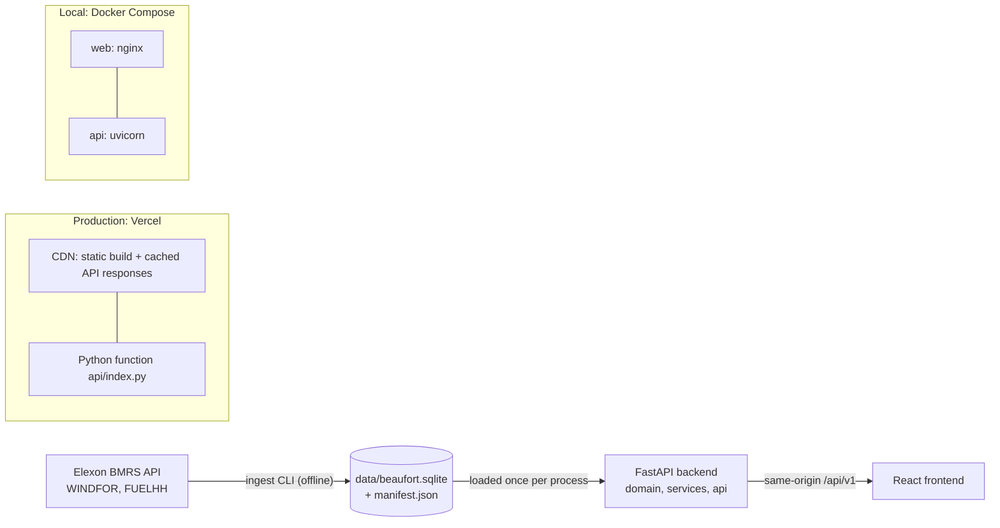

# Architecture

## Overview

There are three runtime pieces:
- **Ingest** is the only code that talks to Elexon. It runs offline and writes a snapshot.
- **The API** reads that snapshot and serves the analytics.
- **The web app** renders what the API returns.

The web app never calls Elexon, and the API never computes anything in the browser's place.

## Backend (`backend/src/beaufort/`)

| Package | Responsibility | Depends on |
|---|---|---|
| `elexon/` | Typed client for the two stream endpoints (7-day chunks, retries with backoff on 429/5xx/timeouts) and Pydantic row models | httpx, pydantic |
| `ingest/` | CLI and pipeline: fetch → validate → upsert → quality report → manifest. Builds into a temp file, then swaps it in atomically | elexon, store |
| `store/` | SQLite schema with natural-key upserts, a content hash, and `load_dataset()` into pandas frames | sqlite3, pandas |
| `domain/` | **Pure logic**: delivery window and gate closure (Europe/London), forecast selection, error metrics, trailing calibration. No I/O | pandas, numpy |
| `services/` | One use case per screen (`Analytics`): day-ahead, runs, accuracy, lead-time curve, meta. Results are memoised per parameter set, since the data is immutable | domain, store |
| `api/` | App factory, routes, problem+json errors, ETag/Cache-Control middleware, GZip. HTTP translation only | services |

The dependency direction is `api → services → domain`, with `store` only reached through `services` and `deps`. All correctness tests target `domain/` and `services/` directly; `api/` tests only check the HTTP contract.

### Request path

1. `GET /api/v1/accuracy?gate_closure=09:50` arrives at FastAPI. Pydantic validates the query (gate closure must be `HH:MM`, dates must be ISO).
2. `get_analytics()` (an `lru_cache` singleton) loads the snapshot on first use, which takes about 30 ms.
3. `Analytics.pairs(09:50)` builds the decision-time forecast/actual pairs for every delivery day once, then caches them. That is about 70 ms the first time.
4. The service slices and aggregates the pairs into a Pydantic response model: MW as integers, timestamps in UTC.
5. Middleware adds an `ETag` (the snapshot hash) and `Cache-Control: s-maxage=604800`. Vercel's CDN then serves repeat requests without invoking Python.

## Frontend (`frontend/src/`)

| Folder | Responsibility |
|---|---|
| `app/` | Routes (`/day-ahead/:date`, `/accuracy`), shell, top bar with the global gate-closure switch and the "Data & method" popover |
| `features/day-ahead/`, `features/accuracy/` | One folder per screen: page, chart option builders (pure functions of data + tokens), local components |
| `components/charts/` | `EChart` wrapper (init/resize/dispose, crosshair groups, click events), the theme read from CSS tokens, shared chart chrome |
| `components/ui/` | Small primitives: stat row, legend toggle, segmented control, skeleton, error state |
| `lib/` | API client and TanStack Query hooks, `schema.d.ts` generated from OpenAPI, UK-time formatting, URL state |

- **State lives in the URL:** gate closure, period and layer toggles. Every view can be shared as a link, and Back/Forward behave as expected.
- **Server state** goes through TanStack Query with `staleTime: Infinity`, because snapshot data never changes. Adjacent days are prefetched.
- **Colours** are CSS custom properties. Tailwind utilities and the ECharts theme both read them, so light and dark mode switch in one place.
- **API types** are generated from FastAPI's OpenAPI schema (`make types`). CI fails if the committed types drift from the backend.

## Environments

| | Local dev | Docker Compose | Production |
|---|---|---|---|
| Static files | Vite dev server | nginx (`web`) | Vercel CDN |
| `/api` | Vite proxy → uvicorn :8000 | nginx → `api:8000` | Vercel rewrite → `api/index.py` (lhr1) |
| Data | `data/` in repo | baked into the image (`/app/data`) | bundled via `includeFiles` |

Because `/api` is same-origin everywhere, there is no CORS configuration, and the frontend build is identical in every environment.

## Quality gates (CI)

`.github/workflows/ci.yml` runs on every push:
- **backend:** ruff, mypy (strict), pytest, and a check that `requirements.txt` matches `uv.lock`.
- **frontend:** oxlint, TypeScript build, vitest.
- **api-types:** regenerates `schema.d.ts` and fails on any diff.
- **docker:** builds both images, starts the stack, and smoke-tests the SPA, health and the golden MAE.
